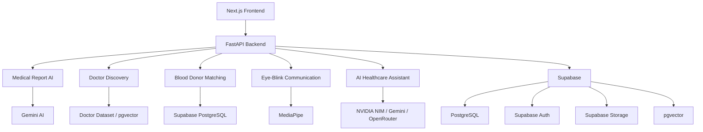

# Pulse Bridge 🩺

### AI-Powered Healthcare Accessibility Platform

**Pulse Bridge** is an AI-powered healthcare accessibility platform designed to make healthcare information easier to understand and medical resources easier to discover.

Built with **Next.js, FastAPI, Python, and Supabase**, Pulse Bridge brings together AI-assisted medical report explanations, doctor discovery, emergency blood donor matching, and assistive eye-blink communication in one unified platform.

> **Mission:** Make healthcare more accessible, understandable, and inclusive through technology.

---

## ✨ Key Features

### 🧪 AI Medical Report Explainer
- Upload medical laboratory reports in PDF or image formats.
- Extract structured biomarker information from reports.
- Understand medical terminology through simplified explanations.
- Supports English and Urdu explanations.
- Highlights abnormal values and provides questions to discuss with a healthcare professional.
- Uses AI-powered document processing and vision capabilities.

### 👨‍⚕️ Intelligent Doctor Discovery
- Search for doctors and medical specialists.
- Discover healthcare professionals using location and specialization filters.
- Filter results by consultation fee, experience, and patient satisfaction.
- Uses structured retrieval and semantic search techniques.
- Provides grounded recommendations from the available doctor dataset.

### 🩸 Emergency Blood Donor Matching
- Search for compatible blood donors.
- Match donors using blood group compatibility.
- Prioritize donors based on location and availability.
- Support emergency blood request workflows.
- Protect donor contact information through privacy-conscious handling.

### 👁️ Eye-Blink Communication
- Assistive communication interface designed for users with limited mobility.
- Uses webcam-based eye tracking and blink detection.
- Built with MediaPipe Face Landmarker.
- Includes personalized blink calibration.
- Converts detected intentional blinks into communication inputs.

### 💬 AI Healthcare Assistant
- Conversational interface for healthcare-related questions.
- AI-powered responses using configurable model providers.
- Supports doctor-directory queries through grounded retrieval.
- Includes provider fallback logic for improved availability.

---

## 🏗️ System Architecture

Pulse Bridge follows a modular architecture with a Next.js frontend, FastAPI backend, and Supabase as its central data platform.



---

## 🛠️ Tech Stack

| Category | Technologies |
|---|---|
| Frontend | Next.js, React, TypeScript |
| Styling | Tailwind CSS |
| UI & Animation | Lucide Icons, Framer Motion |
| Backend | Python, FastAPI |
| API Validation | Pydantic |
| Database | Supabase PostgreSQL |
| Authentication | Supabase Auth |
| File Storage | Supabase Storage |
| Vector Search | pgvector |
| AI & Vision | Google Gemini |
| AI Model Providers | NVIDIA NIM, OpenRouter |
| Computer Vision | MediaPipe |
| Document Processing | PyMuPDF, Pillow |
| Data Processing | Pandas, NumPy |
| Testing | Pytest |

---

## 📁 Project Structure

```text
Pulse-Bridge/
│
├── backend/
│   ├── api/
│   │   └── routes.py
│   │
│   ├── core/
│   │   ├── config.py
│   │   ├── guardrails.py
│   │   └── supabase_client.py
│   │
│   ├── models/
│   │   └── schemas.py
│   │
│   ├── modules/
│   │   ├── doctors/
│   │   ├── eye_comm/
│   │   └── report/
│   │
│   ├── scripts/
│   │   ├── apply_migrations.py
│   │   └── seed_embeddings.py
│   │
│   ├── main.py
│   ├── requirements.txt
│   └── .env.example
│
├── frontend/
│   ├── public/
│   │   ├── images/
│   │   └── models/
│   │
│   ├── src/
│   │   ├── app/
│   │   ├── components/
│   │   ├── lib/
│   │   └── types/
│   │
│   ├── package.json
│   └── README.md
│
├── data/
│   └── doctors.csv
│
├── docs/
│   ├── ARCHITECTURE.md
│   ├── API_CONTRACTS.md
│   ├── DATABASE_SCHEMA.md
│   ├── DEVELOPMENT_PLAN.md
│   └── EYE_COMMUNICATION_PLAN.md
│
├── supabase/
│   └── migrations/
│
├── tests/
│
├── .env.example
└── README.md
```

---

## 🚀 Getting Started

Follow these steps to run Pulse Bridge locally.

### Prerequisites

Make sure you have the following installed:

- [Python 3.13](https://www.python.org/downloads/)
- [Node.js](https://nodejs.org/)
- [Git](https://git-scm.com/)
- A [Supabase](https://supabase.com/) project
- API credentials for the AI providers you intend to use

### 1. Clone the Repository

```bash
git clone https://github.com/Taha19-coder/Pulse-Bridge.git

cd Pulse-Bridge
```

### 2. Configure the Backend

Create a virtual environment:

```bash
python -m venv .venv
```

Activate it on Windows:

```bash
.venv\Scripts\activate
```

Activate it on macOS or Linux:

```bash
source .venv/bin/activate
```

Install backend dependencies:

```bash
pip install -r backend/requirements.txt
```

Create your backend environment file:

```bash
copy backend\.env.example backend\.env
```

On macOS or Linux:

```bash
cp backend/.env.example backend/.env
```

Configure the required environment variables in `backend/.env`.

### 3. Configure Environment Variables

The backend uses environment variables for database connectivity, AI providers, and application configuration.

```env
# Supabase
SUPABASE_URL=https://your-project-id.supabase.co
SUPABASE_ANON_KEY=your-supabase-anon-key
SUPABASE_SERVICE_ROLE_KEY=your-supabase-service-role-key

# AI Providers
GEMINI_API_KEY=your-gemini-api-key
NVIDIA_NIMS_API_KEY=your-nvidia-nim-api-key
OPENROUTER_API_KEY=

# NVIDIA Model
NVIDIA_NIMS_CHAT_MODEL=deepseek-ai/deepseek-v4.1-flash

# Application
ENVIRONMENT=development
PORT=8000
HOST=0.0.0.0
CORS_ORIGINS=http://localhost:3000,http://127.0.0.1:3000
```

**Important:** Never commit your actual API keys or secret credentials to GitHub.

### 4. Set Up the Supabase Database

Pulse Bridge uses Supabase as its central database and storage platform.

Apply the SQL migrations located in:

```text
supabase/migrations/
```

Run the migrations in the numbered order using the Supabase SQL Editor or your preferred migration workflow.

The migrations configure the database structure, required extensions, doctor vector search, user profiles, and report-related storage.

### 5. Start the Backend

From the repository root:

```bash
python -m uvicorn backend.main:app --reload --host 0.0.0.0 --port 8000
```

The backend API will be available at:

**http://localhost:8000**

Interactive API documentation:

**http://localhost:8000/docs**

Health check:

**http://localhost:8000/api/v1/health**

### 6. Configure the Frontend

Open a new terminal:

```bash
cd frontend
```

Install dependencies:

```bash
npm install
```

Create the frontend environment file:

```bash
copy ..\.env.example .env.local
```

On macOS or Linux:

```bash
cp ../.env.example .env.local
```

Configure the frontend variables in `frontend/.env.local`:

```env
NEXT_PUBLIC_SUPABASE_URL=https://your-project-id.supabase.co
NEXT_PUBLIC_SUPABASE_ANON_KEY=your-supabase-anon-key
NEXT_PUBLIC_API_URL=http://localhost:8000/api/v1
```

Only public, client-safe credentials should use the `NEXT_PUBLIC_` prefix.

### 7. Run the Frontend

Start the development server:

```bash
npm run dev
```

Open your browser:

**http://localhost:3000**

You should now have the frontend and backend running locally.

---

## 🔌 API Overview

The backend exposes RESTful endpoints through FastAPI.

| Method | Endpoint | Description |
|---|---|---|
| GET | `/api/v1/health` | Backend health and configuration status |
| POST | `/api/v1/reports/explain` | Analyze and explain medical reports |
| POST | `/api/v1/doctors/search` | Search the doctor directory |
| GET | `/api/v1/doctors/filters/meta` | Retrieve doctor search filters |
| POST | `/api/v1/rag/chat` | AI assistant and doctor-directory chat |
| POST | `/api/v1/eye-comm/calibrate` | Calibrate eye-blink communication |

Additional API contracts and implementation details are documented in:

[`docs/API_CONTRACTS.md`](docs/API_CONTRACTS.md)

---

## 🧠 AI & Retrieval Design

Pulse Bridge combines AI generation with structured retrieval to improve the usefulness and reliability of healthcare information.

### Medical Report Processing

The report-processing pipeline is designed to:

1. Extract text from digital PDF documents.
2. Process scanned documents and images using vision capabilities.
3. Extract structured biomarker information.
4. Generate simplified explanations.
5. Apply medical safety guardrails.

### Doctor Retrieval

The doctor discovery module combines:

- Structured filtering
- Specialty and location matching
- Keyword relevance
- Semantic embeddings
- Hybrid retrieval and ranking

Doctor recommendations are grounded in the available dataset rather than generated from unrestricted model knowledge.

---

## 🔐 Privacy & Safety

Healthcare applications require careful handling of personal and medical information.

Pulse Bridge is designed with the following principles:

- Medical report files are intended to be stored in private Supabase Storage.
- Supabase Row Level Security is used to help protect user data.
- Backend-only credentials must never be exposed to the frontend.
- Donor contact information should be protected through consent-aware handling.
- AI-generated medical explanations are educational and must not replace professional medical advice.
- The platform does not intend to provide medical diagnoses or prescribe medication.

**Medical Disclaimer:** Pulse Bridge is an educational healthcare accessibility project. AI-generated explanations may contain errors and should not be used as a substitute for professional medical consultation, diagnosis, or treatment.

---

## 🧪 Testing

Run the backend test suite from the repository root:

```bash
pytest
```

Or run the tests directory explicitly:

```bash
pytest tests/
```

The repository includes tests covering API integration, doctor retrieval, eye-blink detection, eye-blink encoding, and report explanation logic.

---

## 📚 Documentation

Detailed project documentation is available in the `docs/` directory.

| Document | Description |
|---|---|
| [Architecture](docs/ARCHITECTURE.md) | System architecture and technology decisions |
| [API Contracts](docs/API_CONTRACTS.md) | API endpoints and request/response schemas |
| [Database Schema](docs/DATABASE_SCHEMA.md) | Supabase tables, policies, and storage |
| [Development Plan](docs/DEVELOPMENT_PLAN.md) | Development roadmap and milestones |
| [Eye Communication Plan](docs/EYE_COMMUNICATION_PLAN.md) | Assistive communication design |

---

## 🌍 Social Impact

Pulse Bridge aligns with **United Nations Sustainable Development Goal 3: Good Health and Well-Being**.

The project focuses on improving:

- Health literacy through accessible medical information.
- Healthcare discovery through structured doctor search.
- Emergency response through blood donor matching.
- Digital inclusion through assistive communication technology.

By combining AI, healthcare data, and accessibility-focused design, Pulse Bridge aims to make essential healthcare information more approachable.

---

## 🛣️ Future Improvements

Potential areas for further development include:

- Expanded verified healthcare provider datasets.
- Improved Urdu and multilingual support.
- Enhanced donor availability and notification workflows.
- More robust authentication and user profile management.
- Additional accessibility features.
- Deployment and production monitoring.
- Expanded automated testing and CI/CD.
- Improved clinical validation and AI evaluation.

---

## 👨‍💻 Author

**Taha Hayyan**

Artificial Intelligence Undergraduate | AI Engineer | Agentic Systems & Automation

- GitHub: [@Taha19-coder](https://github.com/Taha19-coder)
- Project: [Pulse Bridge](https://github.com/Taha19-coder/Pulse-Bridge)

---

## 📄 License

A license has not yet been specified for this repository.

If you intend to make Pulse Bridge open source, consider adding a `LICENSE` file before publishing it for reuse.

---

<p align="center">
  Built with ❤️ to make healthcare more accessible.
</p>

